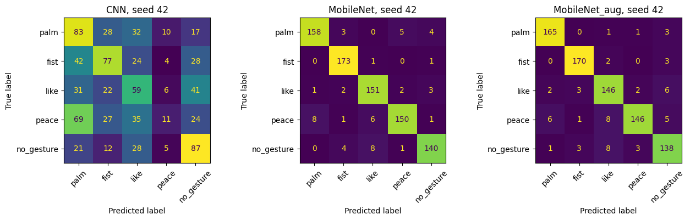

# Touchless Presentation Control — Local VS Code App

This is the English local desktop version of your Colab gesture project. The selected trained MobileNetV2 model and five labeled example crops are bundled in `models.zip` and extracted to `models/` automatically on first use. You do not need Colab or an internet connection to make predictions after installation.

## Installation (Python 3.12)

Open this folder in VS Code. Install Python 3.12 with Tk support, then run:

```sh
python3.12 -m venv .venv
source .venv/bin/activate
python -m pip install -r requirements.txt
```

Launch the app:

```sh
.venv/bin/python app.py
```

In VS Code, select `.venv/bin/python` as the interpreter, then run `app.py`.

For a new machine, use Python 3.12 with Tk support, create a virtual environment and install `requirements.txt`. A Python 3.14 installation is not used for this project. The selected model was trained with TensorFlow 2.21.0.

## First test without a camera

Choose **Thumbs up**, enable **gesture commands**, then click **Replay hold**. This feeds the real model four copies of a labeled example, applying the same hold/cooldown logic as live use. It should start the built-in presentation. Choose **Open palm** and replay again to advance. Replay results are demonstrations, not live-camera performance measurements. Images were selected by their test order, not correctness.

**Predict** makes a single image prediction and disables live commands. Upload accepts a tightly cropped hand photo; it uses the central square. A whole-body photo is outside the trained crop task.

## Webcam

Click **Start camera**. Grant macOS camera permission to the application that launches Python, normally VS Code or Terminal. If access is denied, use System Settings → Privacy & Security → Camera and restart the launching application. The app does not change permissions itself. Try another camera index if the selected device is unavailable.

Put one hand inside the square. Enable gesture commands, hold a gesture steadily for at least 0.7 seconds and three predictions, and relax the hand between repeated commands. There is a 1.4-second cooldown and a 2-second maximum gap between observations. Stop camera / Escape disables gesture commands and external control. Frames remain on this Mac and are not recorded.

## Command mapping

| Gesture | Built-in presentation | External slideshow |
|---|---|---|
| Open palm | Next slide | Right arrow |
| Closed fist | Previous slide | Left arrow |
| Thumbs up | Start at first slide | Home key; start slideshow mode manually first |
| Peace / two fingers | Toggle the on-screen pointer marker | No external key |
| Neutral hand / below score gate | No command | No command |

The pointer marker is a visual toggle, not fingertip tracking.

## Optional external presentation control

Start your slideshow manually in PowerPoint or Google Slides. Start the camera, then select **External slide control…** and read the confirmation. After enabling, you have five seconds to focus your slideshow. The app sends keys to the focused application, so focus the intended presentation. Camera gestures alone send external keys; replay and uploaded photos never do.

macOS Accessibility permission for VS Code or Terminal is required for simulated keys. The app refuses external mode if the keyboard listener is not trusted. **F9** stops external control globally (some keyboards require Fn+F9). It automatically stops after 60 seconds. The Stop camera button also disables it. Do not depend on a classifier as a security or safety control.

## Verification

```sh
.venv/bin/python -m unittest test_controller.py
.venv/bin/python app.py --verify
.venv/bin/python app.py --image models/example_palm.png
```

`--verify` compares this Mac's predictions against the exact Colab reference predictions for all five exported crops. It verifies model transfer and preprocessing, not accuracy on every new person or camera.

## Research context and limits

The original study compares a small CNN, MobileNetV2 and MobileNetV2 with augmentation, using 4,000 crops and person-disjoint splits. MobileNetV2 mean test accuracy was 93.68% across two seeds. The deployable seed-42 checkpoint was selected by validation loss, not test accuracy. Its score gate was selected on validation data only.

Test accuracy on annotated crops is not live-webcam command accuracy. Unknown objects may receive high scores. The neutral-hand class does not cover all backgrounds. Hold logic reduces brief activations but cannot guarantee no false commands. A separate live study is still needed. See `Touchless_Presentation_Control.ipynb` for the full experiment.

## Data/model attribution

HaGRID by Alexander Kapitanov and collaborators: https://github.com/hukenovs/hagrid and https://arxiv.org/abs/2206.08219.
Downscaled HaGRID sample by Christian Mills: https://huggingface.co/datasets/cj-mills/hagrid-sample-30k-384p, revision 40b00da; dataset card CC BY-SA 4.0. Exported example crops are derived from that dataset. Preserve applicable attribution and licensing when redistributing. MobileNetV2 uses ImageNet-pretrained features. The additional classifier was trained in this project.

## Results

| Model | Mean test accuracy (2 seeds) |
|---|---:|
| Custom CNN | 37.42% |
| MobileNetV2 | 93.68% |
| MobileNetV2 + augmentation | 93.32% |



The scores above are held-out hand-crop results, not live camera accuracy.
